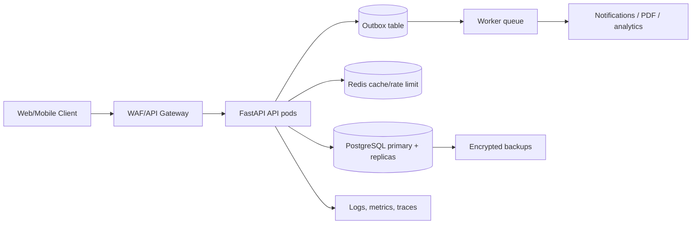

# Architecture and Reliability Design

## 1. High-level architecture



The first deployable unit is a modular monolith: auth, scheduling, consultations, prescriptions, search, audit and analytics share one codebase but have explicit service boundaries. This minimizes distributed transaction complexity while allowing independent extraction later. At the target of 100,000 daily consultations, the API tier is stateless and horizontally scalable; PostgreSQL remains authoritative.

## 2. Booking flow

```mermaid
sequenceDiagram
  participant P as Patient
  participant A as API
  participant DB as PostgreSQL
  participant W as Worker
  P->>A: POST /consultations + Idempotency-Key
  A->>DB: Begin transaction
  A->>DB: SELECT slot FOR UPDATE
  alt slot available
    A->>DB: Update slot=BOOKED; insert consultation; audit event
    A->>DB: Commit
    A-->>P: 201 consultation
    A->>W: Publish outbox event
  else already booked
    A-->>P: 409 conflict
  end
  P->>A: retry same key
  A-->>P: original consultation response
```

## 3. Performance and scale

The read target is p95 <200 ms and write target <500 ms excluding downstream providers. Use indexed filters on doctor/specialty/time/status, cursor pagination, bounded result sets, connection pooling and read replicas for search. Redis can cache public doctor profiles and availability for seconds, but booking always revalidates in PostgreSQL. Partition `consultations` and `audit_logs` by created month once volume requires it; retain hot data in primary and archive older audit data to immutable object storage.

## 4. Transactions, concurrency and sagas

Booking is a single ACID transaction with row-level locking, unique constraints and an idempotency key. Consultation status changes follow an explicit state machine. Payment, video-room creation, notification and prescription delivery are external side effects and must not run inside the database transaction. Write an outbox row in the same transaction, then workers claim rows with leases, retry transient failures using exponential backoff plus jitter (1s, 2s, 4s, 8s, capped at 5m), and send permanent failures to a DLQ. A saga compensates by cancelling/expiring a booking when payment or room provisioning fails.

## 5. Availability and DR

Target 99.95% monthly availability. Run at least three API replicas across zones, managed PostgreSQL Multi-AZ, automated point-in-time recovery, encrypted daily snapshots, Redis with replica/failover, and a versioned container image. RPO target is 5 minutes and RTO target is 30 minutes. Quarterly restore drills validate backups, migration replay, DNS failover and audit integrity. The readiness endpoint must verify dependencies in production; liveness must remain dependency-free.

## 6. Observability

Every request receives a correlation ID. Export RED metrics (rate, errors, duration), saturation, DB pool usage, booking conflicts, queue lag and status transition failures. Use OpenTelemetry trace context across API, DB and workers; redact PHI at the logging boundary. Alerts: p95 latency, 5xx rate, database saturation, replication lag, failed jobs, backup age and certificate expiry.
